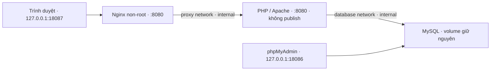
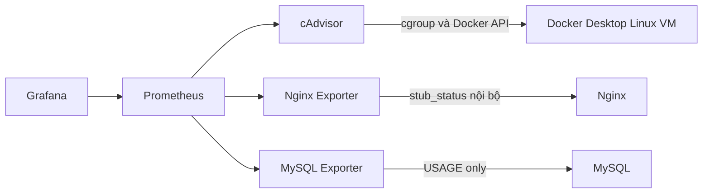
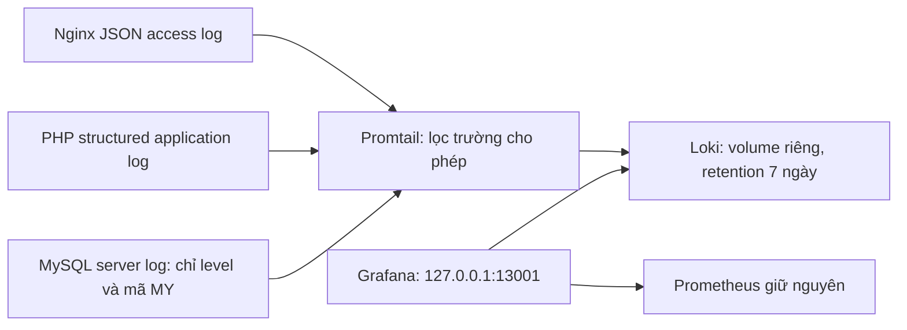

# Hệ thống điểm danh sinh viên — Đề 27

Triển khai **Giai đoạn 1–3** bằng PHP 8.3, PDO, MySQL 8.4, phpMyAdmin, Docker Compose, Nginx và Prometheus/Grafana. Mã nguồn được viết mới từ các file khung rỗng trong workspace; không lấy mã từ container điểm danh cũ.

## Khởi chạy trên Windows

Cần Docker Desktop đang chạy Linux containers và Docker Compose.

```powershell
cd C:\Users\Admin\OneDrive\Desktop\attendance-system
powershell -NoProfile -ExecutionPolicy Bypass -File scripts/setup-env.ps1
powershell -NoProfile -ExecutionPolicy Bypass -File scripts/setup-monitoring.ps1
docker compose config --quiet
docker compose up -d db
# Chờ db healthy, rồi khởi chạy backend trước Nginx:
docker compose up -d --build web phpmyadmin
powershell -NoProfile -ExecutionPolicy Bypass -File scripts/start-monitoring.ps1
docker compose up -d --build
docker compose ps
```

Nếu `.env` đã có, bỏ qua `setup-env.ps1`; nếu `.env.grafana` và `secrets/` đã có, bỏ qua `setup-monitoring.ps1`. Cả hai script cố ý không ghi đè credentials. Mật khẩu sinh bằng bộ sinh số ngẫu nhiên mật mã, không lưu trong Git. Nginx dùng cổng cố định 18087; phpMyAdmin dùng `PMA_PORT` (mặc định 18086). Biến `WEB_PORT=18085` trong `.env` cũ được giữ nguyên nhưng không còn được Compose sử dụng. Không đổi mật khẩu trong `.env` sau khi đã khởi tạo volume mà chưa đổi mật khẩu tài khoản MySQL tương ứng.

- Website qua Nginx: http://127.0.0.1:18087
- Prometheus: http://127.0.0.1:19090
- Grafana: http://127.0.0.1:13001 — user/mật khẩu trong `.env.grafana`, không dùng mật khẩu mặc định.
- phpMyAdmin: http://localhost:18086 — server `db`, tài khoản `attendance_app`, mật khẩu `DB_PASSWORD` trong `.env`. Tài khoản này chỉ có SELECT/INSERT/UPDATE/DELETE; quản trị schema dùng `root` và `DB_ROOT_PASSWORD` khi cần.
- Project Compose: `attendance-phase1-fresh`; volume: `attendance-phase1-fresh_phase1_data`.
- MySQL và PHP web không publish cổng ra host. Nginx và phpMyAdmin chỉ bind loopback; cổng 18085 không còn được bộ này sử dụng.
- Container và volume của các dự án cũ không được tái sử dụng hay xóa. Không dùng `down -v`, `prune` hoặc tên project cũ.

Sau khi sửa PHP/CSS, chạy `docker compose up -d --build web` vì mã được COPY vào image. Dừng riêng bộ này và giữ dữ liệu bằng `docker compose stop`; chạy lại bằng `docker compose start`. SQL khởi tạo chỉ chạy trên volume mới, không tự cập nhật database đã tồn tại.

## Thao tác

1. **Lớp học**: thêm lớp, sửa mã/tên. Chỉ xóa lớp trống, chưa có quan hệ dữ liệu.
2. **Sinh viên**: thêm mã, họ tên, lớp, email tùy chọn; mở từng dòng để sửa. Ngừng theo dõi/khôi phục giữ nguyên lịch sử. Không chuyển lớp nếu đã có danh sách điểm danh.
3. **Điểm danh**: tạo buổi với lớp và ngày giờ (UTC+7), mở danh sách, chọn có mặt/vắng mặt/đi muộn rồi lưu. Có thể lưu lại để sửa trạng thái.
4. **Lịch sử**: lọc theo lớp, sinh viên, khoảng ngày; phân trang 50 dòng.
5. **Thống kê**: số lượt theo trạng thái, tỷ lệ tham dự từng sinh viên. Tỷ lệ = (có mặt + đi muộn) / tổng lượt đã ghi; bỏ qua trạng thái chưa điểm danh.

Lớp cần có sinh viên đang học trước khi tạo buổi. Danh sách được chụp tại thời điểm tạo buổi; thêm/khôi phục sinh viên sau đó chỉ ảnh hưởng các buổi mới. Không tự đánh vắng sinh viên chưa được ghi nhận. Database mặc định rỗng, không chứa dữ liệu demo giả làm dữ liệu thật.

## Cấu trúc

| Đường dẫn | Nội dung |
|---|---|
| `app/index.php` | Tổng quan và buổi học gần đây |
| `app/classes.php`, `app/students.php` | Quản lý lớp và sinh viên |
| `app/attendance.php` | Tạo buổi, ghi và sửa điểm danh |
| `app/history.php`, `app/statistics.php` | Tra cứu và thống kê |
| `app/includes/` | PDO, validation, CSRF, layout, escaping, xử lý lỗi |
| `app/assets/` | Giao diện tiếng Việt responsive, không phụ thuộc CDN |
| `database/init.sql`, `database/permissions.sql` | Schema và quyền tối thiểu |
| `Dockerfile`, `docker/php.ini`, `docker-compose.yml` | Môi trường riêng Giai đoạn 1 |
| `scripts/`, `tests/` | Sinh cấu hình và kiểm thử thực tế |
| `docs/phase1-validation.md` | Kết quả, giới hạn kiểm chứng |

## Thiết kế và an toàn

`classes → students`, `classes → sessions`, `sessions + students → attendance`. Các bảng có PK và FK InnoDB. PK kép `(session_id, student_id)` chống ghi trùng; unique `(class_id, starts_at)` chống tạo buổi trùng giờ; mã lớp và mã sinh viên là duy nhất. Xóa lớp có dữ liệu bị RESTRICT. Xóa buổi sẽ cascade các lượt của chính buổi đó; giao diện không cung cấp chức năng xóa buổi.

PDO sử dụng native prepared statements và bind giá trị, theo [tài liệu PHP](https://www.php.net/manual/en/pdo.prepare.php). Các bộ lọc động chỉ sử dụng tên cột/toán tử từ danh sách cố định. Dữ liệu xuất HTML được escape; POST có CSRF token; kiểm tra ID, mã, độ dài Unicode, email, ngày giờ và trạng thái. Ghi điểm danh và chụp danh sách dùng transaction. Lỗi nội bộ được ghi log, không xuất mật khẩu hay SQL ra giao diện.

Web chạy bằng `www-data`, bỏ capabilities và bật `no-new-privileges`; DB ở network internal, tài khoản ứng dụng không có DDL. Có CSP, chống framing, nosniff và cookie HttpOnly/SameSite. Tên project riêng cô lập tài nguyên theo [tài liệu Compose](https://docs.docker.com/compose/how-tos/project-name/).

## Kiểm thử

```powershell
powershell -NoProfile -ExecutionPolicy Bypass -File scripts/test.ps1
```

Script kiểm tra cấu hình Compose, cú pháp toàn bộ PHP, rồi chạy HTTP thật từ container web và kiểm tra trực tiếp MySQL. Dữ liệu kiểm thử có tiền tố ngẫu nhiên và được dọn bằng ID trong `finally`; không truncate hay xóa dữ liệu có sẵn. Không cung cấp endpoint chạy test trên website. Chạy trên môi trường Giai đoạn 1 riêng, tránh chạy khi đang thao tác dữ liệu thủ công.

## Giới hạn phạm vi

Ứng dụng hiện phục vụ bài thực hành trên máy cục bộ, **chưa có đăng nhập/phân quyền người dùng và HTTPS**. Đã kiểm tra giao diện bằng Chrome headless ở 390/768/1440px; chưa kiểm tra trên thiết bị vật lý hoặc Safari/Firefox. Bảng dữ liệu cuộn ngang trên màn hình nhỏ. Nginx thuộc Giai đoạn 2, Prometheus/Grafana thuộc Giai đoạn 3. Chưa triển khai Loki/Promtail hoặc hardening toàn bộ stack; các file khung logging vẫn rỗng. Không coi kết quả hiện tại là hoàn tất toàn bộ đề thi.

Repository Git riêng được tạo trong workspace để lưu mã nguồn Giai đoạn 1. GitHub: https://github.com/dtc245200364-del/attendance-system. Commit đầu tiên: `feat: implement attendance application and MySQL database`. Các commit tiếp theo và báo cáo tối thiểu 10 trang thuộc phần việc sau; không tạo ảnh minh chứng giả.

## Nghiệm thu Giai đoạn 1 — 16/10/2026

Kết quả cuối: **72 kiểm tra HTTP/MySQL + 29 kiểm tra Chrome + 17 kiểm tra hạ tầng/an toàn = 118 đạt, 0 thất bại**; 8 file ứng dụng PHP qua kiểm tra cú pháp. Chi tiết và giới hạn tại [biên bản nghiệm thu](docs/phase1-acceptance.md). [Ảnh chụp trình duyệt thật](docs/evidence/README.md) dùng dữ liệu có nhãn kiểm thử; không phải dữ liệu điểm danh thực tế.

```powershell
powershell -NoProfile -ExecutionPolicy Bypass -File scripts/test.ps1
powershell -NoProfile -ExecutionPolicy Bypass -File scripts/browser-test.ps1
powershell -NoProfile -ExecutionPolicy Bypass -File scripts/acceptance-check.ps1
```

Kiểm thử trình duyệt cần Google Chrome ở đường dẫn mặc định Windows; dùng cổng DevTools loopback 19227, profile riêng trong `tests/.browser-profile-*` đã được ignore. Có thể đổi `-Port`/`-DebugPort` khi cần. Dữ liệu kiểm thử được tạo bằng tiền tố ngẫu nhiên, dọn theo đúng lớp của lượt chạy; không xóa dữ liệu cũ. `acceptance-check.ps1` đăng nhập phpMyAdmin bằng user ứng dụng, đọc mật khẩu trong `.env` vào bộ nhớ và không in ra. Cần quyền truy cập Docker và Git repository riêng của workspace. Các script được cập nhật cho kiến trúc Giai đoạn 2; con số 118 phía trên là kết quả lịch sử tại thời điểm nghiệm thu Giai đoạn 1.

Database đã bổ sung `database/consistency.sql`: trigger chặn thêm/sửa điểm danh khác lớp, chuyển lớp sinh viên có lịch sử và chuyển lớp buổi có danh sách. Cú pháp dựa trên [tài liệu CREATE TRIGGER của MySQL 8.4](https://dev.mysql.com/doc/refman/8.4/en/create-trigger.html). Với volume mới, Compose tự áp dụng sau schema và phân quyền. Với volume Giai đoạn 1 đã tồn tại, áp dụng **một lần** bằng:

```powershell
docker compose cp database/consistency.sql db:/tmp/attendance-consistency.sql
docker compose cp scripts/apply-consistency.sh db:/tmp/attendance-consistency.sh
docker compose exec -T db sh /tmp/attendance-consistency.sh
```

Script chỉ bổ sung trigger chưa có, không xóa bảng hoặc dữ liệu. Thay đổi nội dung trigger trong tương lai cần migration riêng. Các script `apply-permissions.sh` và `cleanup-test-artifact.*` là công cụ sửa sự cố của lần dựng đầu, không cần chạy trong quy trình khởi động thông thường.

**Git:** tại thời điểm nghiệm thu, Git root còn là `C:/Users/Admin`; các biên bản nghiệm thu lưu lại hiện trạng đó. Khi chuẩn bị Commit 1, đã tạo repository riêng ngay trong `attendance-system`. `.env`, profile trình duyệt, log và file tạm được ignore; `.env.example` chỉ chứa giá trị mẫu. Chỉ stage file dự án trong repository riêng, không chạy `git add` ở repository cha và không force push.

## Giai đoạn 2 — Nginx reverse proxy



Giữ project name `attendance-phase1-fresh` để giữ đúng volume. Mạng proxy riêng `172.30.87.0/29`: Nginx `.2`, web `.3`; không dùng subnet này cho stack khác. Nginx không tham gia mạng database; web không tham gia mạng frontend. Apache chỉ cho phép kết nối từ `.2` và loopback bên trong container (healthcheck/regression). `RemoteIPInternalProxy` chỉ tin `.2`; HTTPS env chỉ được thiết lập từ peer `.2`. Nginx ghi đè Host/X-Forwarded-For/X-Forwarded-Proto, xóa Forwarded; không tin chuỗi proxy do client cung cấp. IP client quan sát được trên Docker Desktop có thể là địa chỉ NAT của host.

Nginx phục vụ HTTP cục bộ, không thiết lập HSTS. Bốn security headers có `always` trên cả CSS và lỗi; ẩn bản sao từ PHP để tránh trùng. CSP chỉ cho tài nguyên cùng origin, tương thích CSS hiện có. Body tối đa 1 MiB, connect timeout 3s, send/read timeout 30s, body timeout 15s, header timeout 10s. Không tự thử lại POST. Lỗi 502/503/504 giữ mã và trả trang tiếng Việt chung; validation 403/409/422 vẫn do ứng dụng xử lý. Read timeout là khoảng chờ giữa các lần đọc, không phải giới hạn tổng thời gian request. Docker DNS được resolve lại để theo IP backend sau rebuild.

Nginx chạy UID 101, root filesystem read-only, ghi file tạm vào tmpfs, bỏ capabilities và bật no-new-privileges. `/healthz` đi qua Nginx → PHP `health.php` → `SELECT 1` ở MySQL, trả 503 nếu DB không sẵn sàng. Web cũng có healthcheck nội bộ. phpMyAdmin giữ đường truy cập cũ và không được proxy trong giai đoạn này.

Áp dụng thay đổi trên stack đang có bằng `docker compose up -d --build --no-deps web nginx`. Compose cần recreate web để thay network/bỏ port; không chạy `down`, không thay/xóa DB hoặc volume. Với cài đặt mới dùng lệnh đầy đủ ở đầu README. Cấu hình Nginx được bind mount: sau khi sửa chạy `docker compose exec nginx nginx -t`, rồi `docker compose exec nginx nginx -s reload`. Khi sửa Compose cần áp dụng lại service liên quan; tránh thao tác với project cũ.

```powershell
# Toàn bộ nghiệp vụ qua Nginx (mặc định mới)
powershell -NoProfile -ExecutionPolicy Bypass -File scripts/test.ps1
# Regression trực tiếp từ bên trong web, không mở cổng host
powershell -NoProfile -ExecutionPolicy Bypass -File scripts/test.ps1 -BaseUrl http://127.0.0.1:8080
powershell -NoProfile -ExecutionPolicy Bypass -File scripts/proxy-test.ps1
powershell -NoProfile -ExecutionPolicy Bypass -File scripts/acceptance-check.ps1
powershell -NoProfile -ExecutionPolicy Bypass -File scripts/browser-test.ps1 -Port 18087
curl.exe -I http://127.0.0.1:18087/
docker compose ps
```

`proxy-test.ps1` tạo listener thử lỗi chỉ trong container (18088/18089) và PHP giả lập nội bộ (18090), lấy từ cấu hình Nginx thật, rút ngắn read timeout test xuống 1s. Dừng các tiến trình test trong `finally`; không dừng backend/DB production, không publish cổng test, không tạo endpoint debug trong document root. Script copy test vào tmpfs Nginx qua stdin vì Docker cp không ghi được container read-only. Cần Docker Desktop, không chạy nhiều lượt test đồng thời.

Kết quả Giai đoạn 2: **242 assertions đạt / 0 thất bại ở lượt cuối của từng bộ**, 9/9 file PHP hợp lệ. Xem [biên bản](docs/phase2-validation.md) và [hướng dẫn tự chụp minh chứng](docs/phase2-screenshots.md). Ảnh test qua proxy lưu riêng trong `docs/evidence/phase2/`. Giai đoạn 2 đã commit/push tại `70bdee6`; biên bản lưu hiện trạng tại lúc nghiệm thu.

## Giai đoạn 3 — Prometheus và Grafana

**Trạng thái hiện tại: đã triển khai và kiểm thử cục bộ.** Sau khi người dùng chuyển Docker disk image sang `D:\DockerDesktopData\DockerDesktopWSL`, Docker hoạt động bình thường. Giai đoạn 3 đạt **147/147 kiểm tra cuối**, 4 targets UP/0 DOWN, 9 panel có dữ liệu thật qua Prometheus và Grafana API; CPU/RAM/network có series cho 9 service. Xem [biên bản thực tế](docs/phase3-validation.md). Lỗi thiếu dung lượng trước đó được lưu như lịch sử, không phải trạng thái hiện tại.



Prometheus scrape mỗi **15s**, timeout **5s**, giữ TSDB tối đa **7 ngày / 1GB** trên volume riêng. Grafana có volume riêng và datasource provisioned `attendance-prometheus`. Dashboard **Attendance System Monitoring** tại http://127.0.0.1:13001/d/attendance-system được provision từ JSON trong `grafana/dashboards/`, không chứa số liệu giả: CPU, RAM working set, network RX/TX theo service, Nginx requests/s, MySQL current/total connections, Nginx active connections và scrape target health. `up` phản ánh scrape endpoint, không thay thế giám sát nghiệp vụ end-to-end. CPU biểu diễn phần trăm một CPU, có thể vượt 100% khi dùng nhiều core.

Mạng `monitoring` là internal. Chỉ Prometheus/Grafana có thêm mạng UI và cổng loopback 19090/13001; exporter không publish host. Nginx Exporter có IP `.4` trên mạng proxy, là peer duy nhất được đọc listener `9091/stub_status`. MySQL Exporter nối monitoring + database, dùng credentials file mount read-only. Nginx không được nối mạng database; Prometheus/Grafana không nối database.

`attendance_monitor` chỉ có **USAGE**, tối đa 3 kết nối; chỉ bật global status/variables, tắt collector cần đọc bảng, replication hoặc quyền PROCESS. Không cấp SELECT trên dữ liệu sinh viên, không dùng root hay user ứng dụng cho exporter. File `secrets/monitoring-user.sql` được sinh cục bộ; `CREATE USER IF NOT EXISTS` không đổi mật khẩu của tài khoản đã tồn tại. Nếu credentials mất/không khớp, cần xử lý có chủ đích, không xóa volume hoặc chạy lại sinh mật khẩu một cách tùy tiện.

**cAdvisor:** chạy root để đọc cgroup của Linux VM, `cgroup: host`, đọc `/`, `/sys`, `/var/lib/docker` và Docker socket; không `privileged`, không thêm capabilities. Docker Desktop hiện cần `--containerd=/rootfs/run/containerd/containerd.sock` để đăng ký Docker factory; socket này nằm trong mount đã có. Tắt collector `disk` vì không cần cho CPU/RAM/network và tránh phải cấp quyền đọc thư mục riêng; không thu OOM events do không cấp `/dev/kmsg`. Docker/containerd socket mount `:ro` vẫn cho phép API thực hiện thao tác ghi nếu tiến trình bị chiếm quyền; đây là quyền nhạy cảm, không tương đương API read-only. Không public cAdvisor; Prometheus chỉ lưu metrics có label project này. cAdvisor vẫn có khả năng quan sát metadata container khác trong Docker VM; không thao tác dừng/sửa chúng. Không dùng stack này như một mô hình tenant isolation mạnh.

Trên stack đã có (không khởi động lại DB): chạy setup monitoring **một lần**, sau đó `scripts/start-monitoring.ps1`. Script cấp tài khoản bằng root bên trong DB, không in mật khẩu, chỉ cập nhật Nginx và service giám sát. Cài mới làm theo thứ tự ở đầu README. Không commit `.env.grafana`, `secrets/`, log hay profile trình duyệt. Grafana chỉ đọc mật khẩu admin lúc khởi tạo database Grafana lần đầu; đổi file env không tự đổi mật khẩu tài khoản đã tồn tại.

```powershell
docker compose config --quiet
docker compose exec prometheus promtool check config /etc/prometheus/prometheus.yml
docker compose ps
powershell -NoProfile -ExecutionPolicy Bypass -File scripts/monitoring-test.ps1
powershell -NoProfile -ExecutionPolicy Bypass -File scripts/monitoring-access-test.ps1
powershell -NoProfile -ExecutionPolicy Bypass -File scripts/test.ps1
powershell -NoProfile -ExecutionPolicy Bypass -File scripts/acceptance-check.ps1
```

Không chạy test đồng thời. Bộ monitoring-test gửi 40 request thật, chờ hai scrape, kiểm tra target UP, nginx_up/mysql_up, tăng counter và cả PromQL lẫn truy vấn qua Grafana cho từng panel. Xem [kết quả thực tế](docs/phase3-validation.md) và [hướng dẫn chụp ảnh](docs/phase3-screenshots.md). Các template datasource/dashboard dựa trên [Grafana provisioning](https://grafana.com/docs/grafana/latest/administration/provisioning/); exporters theo [NGINX Exporter](https://github.com/nginx/nginx-prometheus-exporter), [MySQL Exporter](https://github.com/prometheus/mysqld_exporter), [cAdvisor](https://github.com/google/cadvisor/blob/master/docs/running.md).

Giai đoạn 3 đã commit/push tại `344f50c`. Chưa triển khai alert rules/Alertmanager. Các UI dùng HTTP loopback; Prometheus không có đăng nhập.

## Giai đoạn 4 — Loki và Promtail

Loki `3.7.8` lưu log trên volume `loki_data`, dùng TSDB v13, compactor retention **168 giờ**, index 24 giờ. Promtail `3.5.12` thu log thật của Nginx, PHP và mã sự kiện máy chủ MySQL; lưu offset trên volume `promtail_positions`. Hai service chỉ thuộc mạng `monitoring` nội bộ, **không publish cổng host**, có giới hạn CPU/RAM. Grafana giữ datasource Prometheus mặc định và dashboard 9 panel; thêm datasource `attendance-loki` và dashboard [Attendance System Logs](http://127.0.0.1:13001/d/attendance-logs).

**Promtail đã EOL từ 02/03/2026**, không còn được bảo trì. Người dùng đã xác nhận bắt buộc dùng cho đề thi cục bộ. Với triển khai lâu dài, chuyển sang [Grafana Alloy](https://grafana.com/docs/alloy/latest/set-up/migrate/from-promtail/). Không dùng cấu hình này như một hệ thống production được hỗ trợ.



Áp dụng trên stack hiện có, từ đúng thư mục dự án (không chạy `down`):

```powershell
docker compose config --quiet
docker compose up -d --build --no-deps web
docker compose exec nginx nginx -t
# Chỉ reload sau khi nginx -t thành công:
docker compose exec nginx nginx -s reload
powershell -NoProfile -ExecutionPolicy Bypass -File scripts/start-logging.ps1
# Nhận datasource mới, giữ nguyên database Grafana trên volume:
docker compose restart grafana
```

Script start yêu cầu Nginx/PHP/MySQL đang chạy, xác minh project/service/log driver rồi sinh `docker-compose.override.yml` cục bộ, được Git và Docker build bỏ qua. File này chỉ mount **đúng ba file JSON log** read-only, không mount thư mục metadata container, Docker socket hoặc log dự án khác. Compose tự đọc override. **Chạy lại script sau khi recreate Nginx/web/db**; nếu Docker xoay file log, restart Promtail để gắn lại file hiện tại, rồi kiểm tra log mới tới Loki. Không tạo file override khác cùng tên. Với stack cài mới, hoàn thành bước khởi tạo ứng dụng và monitoring bên trên trước, rồi mới chạy script logging.

Promtail dùng UID 0 để đọc file Docker thuộc root; bỏ toàn bộ capabilities, root filesystem read-only, chỉ ghi positions trên volume riêng. Loki dùng UID 10001. Không cấp privileged hoặc mount socket cho hai dịch vụ mới. cAdvisor vẫn giữ quyền đã ghi trong Giai đoạn 3.

Nginx ghi method giới hạn, route từ allowlist, status, level và request ID do edge tạo; không ghi IP/query/cookie/body vào access log mới. PHP ghi sự kiện `request_completed` và exception chung, không ghi message/stack trace/SQL. Promtail bỏ mọi dòng không khớp định dạng được duyệt; log MySQL chỉ giữ severity và mã `MY-xxxxxx`, không giữ câu SQL hay nội dung thông báo. Các nhãn là `job`, `service`, `container`, `log_type`, `level`, `status` nếu có; request ID chỉ ở nội dung để tránh cardinality cao. Raw log Docker của Apache/Nginx error có thể vẫn chứa dữ liệu request, **không chuyển những dòng đó vào Loki**, không đưa raw log lên GitHub.

```powershell
powershell -NoProfile -ExecutionPolicy Bypass -File scripts/logging-test.ps1
powershell -NoProfile -ExecutionPolicy Bypass -File scripts/test.ps1
powershell -NoProfile -ExecutionPolicy Bypass -File scripts/monitoring-test.ps1 -ResultPath docs/phase4-monitoring-results.json
powershell -NoProfile -ExecutionPolicy Bypass -File scripts/monitoring-access-test.ps1
powershell -NoProfile -ExecutionPolicy Bypass -File scripts/acceptance-check.ps1
# Trước/sau regression có thể lưu fingerprint bằng scripts/data-fingerprint.ps1.
# Chỉ chạy final check sau khi đã có hai file fingerprint và kết quả logging:
powershell -NoProfile -ExecutionPolicy Bypass -File scripts/logging-final-check.ps1
```

Trong Grafana → Explore → datasource **Loki**, dùng:

```logql
{job="attendance",service="nginx"}
{job="attendance",service="nginx"} | json | status = 404
sum by (service) (count_over_time({job="attendance"}[5m]))
```

Tạo 404 mới tại http://127.0.0.1:18087/phase4-log-proof; chọn Last 15 minutes và Refresh. Log MySQL chủ yếu phát sinh lúc khởi động: tăng khoảng thời gian nếu chưa thấy, không restart DB để tạo log. Xem [biên bản nghiệm thu](docs/phase4-validation.md) và [hướng dẫn tự chụp minh chứng thật](docs/phase4-screenshots.md). Chưa commit/push Giai đoạn 4.
