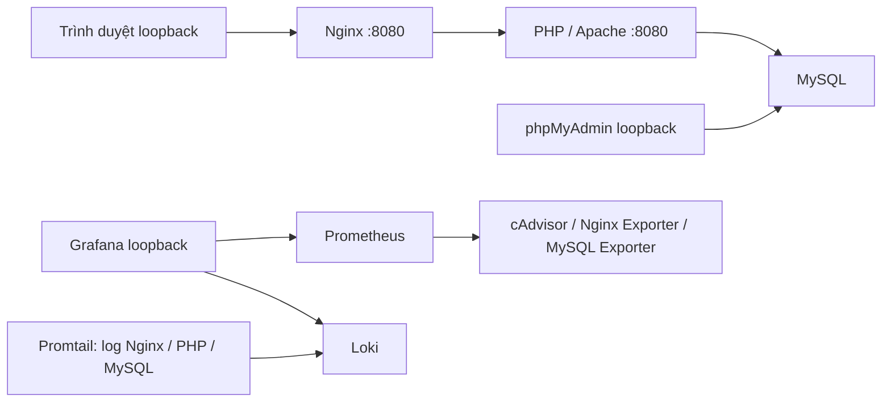

# Hệ thống điểm danh sinh viên — Đề 27

Ứng dụng PHP 8.3/PDO, MySQL 8.4 và Docker Compose, có giao diện tiếng Việt, Nginx reverse proxy, Prometheus/Grafana, Loki/Promtail và hardening.

**Trạng thái triển khai cập nhật ngày 23/10/2026:** đăng nhập, đăng xuất và phân quyền **Admin/Giảng viên đã triển khai thành công** tại http://127.0.0.1:18087. Theo [biên bản production 2B](docs/auth-stage2b-live.md), migration xác thực đã hoàn tất, website đã tắt bảo trì; đăng nhập/đăng xuất Admin, sáu menu, CSRF và hash dữ liệu nghiệp vụ đã được xác minh. Quyền Giảng viên được kiểm thử trên database cách ly; không tạo tài khoản thử hoặc phân công thử trên production.

Lần chỉnh README này đối chiếu mã nguồn, cấu hình và hồ sơ triển khai; **chưa xác minh lại runtime** vì không kết nối được Docker API và HTTP cục bộ. Các số liệu nghiệm thu bên dưới là kết quả lịch sử, không cộng thành tổng kiểm thử hiện tại.

## Các giai đoạn đã hoàn thành

| Giai đoạn | Phạm vi | Commit |
|---|---|---|
| 1 | Ứng dụng PHP/PDO, MySQL, Docker Compose | `fcc371b` |
| 2 | Nginx reverse proxy và security headers | `70bdee6` |
| 3 | Prometheus, Grafana và exporters | `344f50c` |
| 4 | Loki/Promtail và dashboard log | `76be11e` |
| 5 | Hardening container, mạng và quyền truy cập | `d84251a` |
| 6 | Chống ghi đè điểm danh cũ, xử lý buổi học, lịch sử và thống kê | `11d81ab` |

Sáu giai đoạn đã có trên `main`. Modern Education Dashboard được commit tại `fec2dcc`, merge qua [Pull Request #1](https://github.com/dtc245200364-del/attendance-system/pull/1), merge commit `fbf4915`. Hồ sơ xác thực thuộc nhánh `feature/dang-nhap-phan-quyen`; triển khai thực tế không đồng nghĩa các thay đổi này đã được commit/merge vào `main`.

## Sáu chức năng và phân quyền

Giữ giao diện Modern Education Dashboard và đúng sáu mục sidebar:

| Chức năng | Thao tác chính |
|---|---|
| Tổng quan | KPI, biểu đồ từ dữ liệu thật và buổi học gần đây |
| Lớp học | Thêm/sửa mã, tên; chỉ xóa lớp trống, chưa có quan hệ dữ liệu |
| Sinh viên | Thêm/sửa, tìm kiếm, ngừng theo dõi/khôi phục; chỉ xóa khi chưa có bất kỳ lượt điểm danh nào |
| Điểm danh | Tạo buổi, ghi/sửa Có mặt, Vắng mặt, Đi muộn |
| Lịch sử | Lọc theo lớp, sinh viên, khoảng ngày; phân trang 50 dòng |
| Thống kê | Số lượt theo trạng thái và tỷ lệ tham dự từng sinh viên |

- **Admin:** quản lý toàn bộ nghiệp vụ; các trang quản trị tài khoản và phân công tại `/accounts.php`, `/assignments.php` yêu cầu Admin ở server, không thêm mục sidebar.
- **Giảng viên:** chỉ xem dữ liệu lớp được phân công và tạo buổi/điểm danh trong phạm vi đó; không sửa lớp, hồ sơ sinh viên, tài khoản hoặc phân công. Chưa được giao lớp thì danh sách trống.
- Chưa đăng nhập được chuyển về `/login.php`. Đăng xuất dùng POST kèm CSRF; phiên hết hạn sau 30 phút không hoạt động hoặc tối đa 8 giờ. Khóa tài khoản/thay đổi phiên bản xác thực sẽ thu hồi phiên cũ.

Lớp cần có sinh viên đang học trước khi tạo buổi. Danh sách được chụp tại thời điểm tạo; thêm/khôi phục sinh viên chỉ ảnh hưởng buổi mới. Không chuyển lớp sinh viên đã có danh sách điểm danh, không tự đánh vắng người chưa được ghi nhận.

Form điểm danh cũ bị từ chối bằng HTTP 409 nếu buổi đã được lưu từ tab/người khác. Cơ chế phiên bản hỗ trợ một container web; chưa hỗ trợ nhiều replica có thư mục tạm riêng. Lịch sử phản ánh trạng thái hiện tại theo thời gian bắt đầu buổi, chưa phải audit trail các lần sửa. Tỷ lệ tham dự = `(Có mặt + Đi muộn) / (Có mặt + Vắng mặt + Đi muộn)`; bỏ qua Chưa điểm danh.

## Khởi chạy trên Windows

Cần Docker Desktop chạy Linux containers và Docker Compose. Chạy từ thư mục repository. Với stack đã có dữ liệu, giữ nguyên credentials, project và volume.

```powershell
powershell -NoProfile -ExecutionPolicy Bypass -File scripts/setup-env.ps1
powershell -NoProfile -ExecutionPolicy Bypass -File scripts/setup-monitoring.ps1
docker compose config --quiet
docker compose up -d db
# Chờ db healthy, rồi khởi chạy backend trước Nginx:
docker compose up -d --build web phpmyadmin
powershell -NoProfile -ExecutionPolicy Bypass -File scripts/start-monitoring.ps1
powershell -NoProfile -ExecutionPolicy Bypass -File scripts/start-logging.ps1
docker compose ps
```

Bỏ qua script setup tương ứng nếu `.env`, hoặc `.env.grafana` và `secrets/`, đã tồn tại. Các script không ghi đè credentials. Mật khẩu được sinh ngẫu nhiên và giữ ngoài Git. Không đổi mật khẩu trong file env sau khi khởi tạo volume nếu chưa đổi tài khoản MySQL tương ứng. Grafana chỉ đọc mật khẩu admin từ env khi khởi tạo database lần đầu.

**Cài mới cần thêm bước xác thực bên dưới:** chuỗi lệnh trên chỉ dựng hạ tầng và schema nghiệp vụ. Compose hiện không tự chạy `database/migrations/001-auth.sql`; website chưa dùng được đăng nhập cho đến khi schema xác thực và Admin đầu tiên sẵn sàng. Không dùng hướng dẫn cài mới để chạy lại migration trên production đã triển khai.

| Dịch vụ | Địa chỉ / truy cập |
|---|---|
| Website qua Nginx | http://127.0.0.1:18087 |
| Prometheus | http://127.0.0.1:19090 |
| Grafana | http://127.0.0.1:13001 — credentials trong `.env.grafana` |
| phpMyAdmin | http://localhost:18086 — server `db`, user `attendance_app`, mật khẩu lấy cục bộ từ `.env` |

Nginx cố định 18087; phpMyAdmin dùng `PMA_PORT` (mặc định 18086). `WEB_PORT=18085` trong env cũ không còn được Compose dùng. MySQL và PHP không publish cổng host; các UI chỉ bind loopback.

Project: `attendance-phase1-fresh`; volume nghiệp vụ: `attendance-phase1-fresh_phase1_data`. Không tái sử dụng/xóa tài nguyên dự án cũ, không dùng `down -v` hoặc `prune`. Dừng và giữ dữ liệu bằng `docker compose stop`, chạy lại bằng `docker compose start`. SQL init chỉ chạy trên volume mới.

Mã PHP/CSS được COPY vào image: sau khi sửa, cần `docker compose up -d --build web`. Sau khi recreate Nginx/web/db, chạy lại `scripts/start-logging.ps1` để cập nhật mount đúng file log. Không rebuild stack đang triển khai chỉ để cập nhật README.

## Cài mới: schema xác thực và Admin đầu tiên

Đã đối chiếu [migration](database/migrations/001-auth.sql), [CLI](scripts/create-admin.php), [Dockerfile](Dockerfile) và [Compose](docker-compose.yml):

1. Database đích phải là môi trường cài mới đã xác định đúng project/volume, có schema nghiệp vụ. Dùng tài khoản quản trị schema để áp dụng `database/migrations/001-auth.sql` vào database đó, chẳng hạn qua tab Import của phpMyAdmin. Tài khoản ứng dụng chỉ có DML, không đủ quyền chạy DDL. Migration chỉ tạo ba bảng xác thực, không tự chạy lúc khởi động và không chạy lại được khi bảng đã tồn tại. Với database có dữ liệu, cần backup, kiểm chứng restore và quy trình migration riêng theo [hồ sơ chuẩn bị](docs/auth-stage2a-preparation.md).
2. Container `web` phải đang chạy mã xác thực, kết nối đúng database bằng các biến `DB_HOST`, `DB_NAME`, `DB_USER`, `DB_PASSWORD` của Compose; bảng `users` đã sẵn sàng và chưa có bất kỳ tài khoản role `admin` nào, kể cả tài khoản bị khóa.
3. Dockerfile chỉ COPY `app/`, không chứa `scripts/create-admin.php`. Web có filesystem read-only, nhưng `/tmp` là tmpfs ghi được cho UID 33. Chép CLI vào đó qua stdin, rồi chạy tương tác từ terminal PowerShell:

```powershell
Get-Content -Raw -Encoding UTF8 scripts/create-admin.php | docker compose exec -T web sh -c 'cat > /tmp/attendance-create-admin.php'
if ($LASTEXITCODE -ne 0) { throw 'Khong chep duoc CLI vao web.' }
try {
    docker compose exec web php /tmp/attendance-create-admin.php
    if ($LASTEXITCODE -ne 0) { throw 'Tao Admin chua thanh cong; xem ma loi CLI.' }
} finally {
    docker compose exec -T web rm -f /tmp/attendance-create-admin.php
}
```

Lệnh tương tác dùng TTY mặc định của `docker compose exec`; **không thêm `-T` vào lệnh chạy PHP**, không pipe mật khẩu. CLI dùng `stty` để tắt echo; cần terminal tương tác có `stream_isatty`, `shell_exec` và `stty` hoạt động. Script nằm ngoài document root, đọc cấu hình PDO từ `/var/www/html/includes/db.php`.

Tên tài khoản gồm 3–64 ký tự `a-z`, số, `.`, `_`, `-`; được chuẩn hóa về chữ thường. Nhập mật khẩu 12–72 byte hai lần trực tiếp tại terminal. CLI dùng `password_hash`, named lock, transaction và xác minh tài khoản trước commit; từ chối nếu đã có Admin. Không có mật khẩu mặc định. Sau thông báo thành công, đăng nhập tại http://127.0.0.1:18087/login.php và thử đăng xuất.

Đây là quy trình suy ra từ mã/cấu hình hiện tại, **chưa chạy lại trọn vẹn trên một cài đặt mới trong lần sửa README này**. Không chạy CLI trên production đã có Admin. Chẩn đoán lỗi xem [hồ sơ CLI cách ly](docs/create-admin-diagnostics.md); tài khoản, container và cổng trong hồ sơ đó là bối cảnh kiểm thử lịch sử.

## Cấu trúc và dữ liệu

| Đường dẫn | Nội dung |
|---|---|
| `app/index.php` | Tổng quan |
| `app/classes.php`, `app/students.php` | Lớp và sinh viên |
| `app/attendance.php`, `app/history.php`, `app/statistics.php` | Điểm danh, lịch sử, thống kê |
| `app/login.php`, `app/logout.php` | Đăng nhập/đăng xuất |
| `app/accounts.php`, `app/assignments.php` | Quản trị tài khoản/phân công, chỉ Admin |
| `app/includes/`, `app/assets/` | PDO, xác thực, CSRF, validation, layout và giao diện nội bộ |
| `database/init.sql`, `database/permissions.sql`, `database/consistency.sql` | Schema nghiệp vụ, quyền DML, trigger nhất quán lớp |
| `database/migrations/001-auth.sql`, `scripts/create-admin.php` | Schema xác thực và CLI Admin đầu tiên |
| `docker-compose.yml`, `Dockerfile`, `docker/`, `nginx/` | Hạ tầng ứng dụng |
| `prometheus/`, `grafana/`, `loki/`, `promtail/` | Giám sát và log |
| `scripts/`, `tests/`, `docs/` | Vận hành, kiểm thử và bằng chứng |

Bốn bảng nghiệp vụ: `classes → students`, `classes → sessions`, `sessions + students → attendance`. PK kép `(session_id, student_id)` chống ghi trùng; unique `(class_id, starts_at)` chống tạo buổi trùng giờ; mã lớp/mã sinh viên duy nhất. FK InnoDB chặn xóa lớp có dữ liệu; xóa buổi cascade các lượt của buổi đó nhưng giao diện không cung cấp thao tác xóa buổi. Trigger chặn điểm danh khác lớp và chuyển lớp khi đã có danh sách.

Ba bảng xác thực đã bổ sung:

| Bảng | Vai trò |
|---|---|
| `users` | Tên đăng nhập duy nhất, password hash, role `admin`/`lecturer`, trạng thái active, `auth_version`, thời điểm tạo |
| `class_lecturers` | Phân công lớp–tài khoản; PK `(class_id, user_id)`, FK tới `classes`/`users`, trạng thái active để thu hồi phân công |
| `auth_limits` | Bucket giới hạn đăng nhập, số lần thử và thời điểm đầu cửa sổ; không lưu mật khẩu hoặc IP thô |

Database cài mới không có dữ liệu demo hay tài khoản mặc định. Không đưa mật khẩu, token, bản sao database hoặc dữ liệu cá nhân vào Git.

## Kiến trúc, giám sát và hardening



- **Nginx:** mạng proxy internal `172.30.87.0/29`, Nginx `.2`, web `.3`, exporter `.4`. Không dùng subnet này cho stack khác. Apache chỉ tin proxy `.2`; Nginx ghi đè forwarding headers, không tin chuỗi client gửi. Nginx không nối database; web không nối frontend. `/healthz` kiểm tra qua PHP tới `SELECT 1` MySQL. CSP, chống framing, nosniff, same-origin áp dụng cả lỗi; body tối đa 1 MiB, không tự retry POST. HTTP cục bộ chưa có HTTPS/HSTS.
- **Prometheus/Grafana:** scrape 15 giây, timeout 5 giây, retention tối đa 7 ngày/1 GB. Dashboard [Attendance System Monitoring](http://127.0.0.1:13001/d/attendance-system) có 9 panel CPU/RAM/network, Nginx, MySQL và target health. `up` chỉ phản ánh scrape endpoint; CPU có thể vượt 100% khi dùng nhiều core. Exporters không publish host; tài khoản MySQL monitor chỉ USAGE, tối đa 3 kết nối, không đọc dữ liệu sinh viên. Chưa có alert rules/Alertmanager.
- **Loki/Promtail:** Loki `3.7.8`, TSDB v13, index 24 giờ, retention 168 giờ; Promtail `3.5.12` lưu positions trên volume riêng. Chỉ mạng monitoring internal, không publish host. Dashboard [Attendance System Logs](http://127.0.0.1:13001/d/attendance-logs). Promtail chỉ mount ba file log đúng container, không mount Docker socket/metadata hoặc log dự án khác. Sau Docker log rotation cần restart Promtail và xác minh log mới tới Loki.
- **Lọc log:** Nginx chỉ ghi trường cho phép, không IP/query/cookie/body; PHP không ghi exception message/stack/SQL; MySQL chỉ giữ severity và mã `MY-xxxxxx` khi chuyển vào Loki. Không đưa raw Docker log lên GitHub. Có thể tra `{job="attendance",service="nginx"}` trong Grafana Explore/Loki.
- **Container:** chín service ứng dụng/observability được hardening read-only, `cap_drop: ALL`, `no-new-privileges`, giới hạn CPU/RAM/PID. PHP UID/GID 33, ghi vào tmpfs giới hạn; session mất khi recreate web. MySQL daemon UID/GID 999 theo image. Các volume dữ liệu giữ riêng.
- **Quyền nhạy cảm:** cAdvisor chạy root, chỉ mount `/proc`, `/sys` và hai Docker/containerd sockets; socket `:ro` vẫn cho phép API ghi nếu tiến trình bị chiếm quyền. Promtail chạy root để đọc file log nhưng không có runtime socket. Không dùng mô hình này làm tenant isolation mạnh.
- **Ứng dụng:** PDO native prepared statements, escape HTML, validation server, CSRF, transaction khi chụp danh sách/ghi điểm danh, kiểm tra quyền theo lớp. Session đổi ID khi login, cookie HttpOnly/SameSite Strict; Secure khi có HTTPS qua proxy tin cậy. Giới hạn đăng nhập 10 lần/15 phút theo tài khoản và IP qua proxy, gồm cả lần thành công.

Promtail đã EOL từ 02/03/2026; được giữ theo yêu cầu bài thực hành. Triển khai lâu dài cần chuyển sang Grafana Alloy. Hệ thống hiện dành cho máy cục bộ tin cậy; chưa có HTTPS, Prometheus không có đăng nhập, chưa có audit trail nghiệp vụ đầy đủ.

## Kiểm thử và hồ sơ nghiệm thu

Với mã xác thực hiện tại, dùng runner **database RAM riêng**; cần nhánh `feature/dang-nhap-phan-quyen`, Docker Desktop và cổng loopback 18099 còn trống. Lượt Chrome cần Chrome ở đường dẫn mặc định Windows. Mỗi lượt tạo project/database mới, dừng đúng project đó; không ghi fixture vào 18087 hoặc stack dùng chung 18098.

```powershell
powershell -NoProfile -ExecutionPolicy Bypass -File scripts/test-auth-disposable.ps1
powershell -NoProfile -ExecutionPolicy Bypass -File scripts/test-auth-disposable.ps1 -Browser
```

Không chạy đồng thời các bộ test. Không chạy các script HTTP/MySQL ghi dữ liệu cũ bằng Compose production. Hướng dẫn test Giai đoạn 1–6 trong các biên bản chỉ phản ánh kiến trúc tại thời điểm nghiệm thu; không mặc định tương thích luồng đăng nhập mới.

| Hồ sơ | Kết quả lịch sử / nội dung |
|---|---|
| [Giai đoạn 1](docs/phase1-acceptance.md) | 118 đạt, 0 thất bại; [kiểm chứng và giới hạn](docs/phase1-validation.md) |
| [Giai đoạn 2](docs/phase2-validation.md) | 242 assertions đạt, 0 thất bại ở lượt cuối từng bộ |
| [Giai đoạn 3](docs/phase3-validation.md) | 147/147; 4 targets UP, 9 panel có dữ liệu thật |
| [Giai đoạn 4](docs/phase4-validation.md) | Pipeline log, lọc trường, retention, bảo toàn dữ liệu |
| [Giai đoạn 5](docs/phase5-validation.md) | Hardening, quyền DB, mạng, filesystem, hash dữ liệu |
| [Giai đoạn 6](docs/phase6-validation.md) | 243 PASS, 0 FAIL; 10/10 PHP lint ngày 17/10/2026 |
| [Modern Education Dashboard](docs/modern-ui-validation.md) | 455 PASS, 0 FAIL; 10/10 PHP lint; trạng thái staging trong hồ sơ là trước merge PR #1 |
| [Xác thực giai đoạn 1 — 23/10/2026](docs/auth-stage1-validation.md) | Cách ly: auth 101/101; hồi quy 72/72, sinh viên 39/39, Giai đoạn 6 39/39, Chrome 17/17 |
| [Xác thực 2A](docs/auth-stage2a-preparation.md) | Backup, restore/migration trên bản sao trước triển khai |
| [Xác thực production 2B — 23/10/2026](docs/auth-stage2b-live.md) | Đã migration, đăng nhập/đăng xuất Admin, mở lại website, hash nghiệp vụ không đổi |

Các câu “chưa đăng nhập”, “chưa migration/triển khai production” trong hồ sơ Giai đoạn 1–6 hoặc xác thực 1/2A là **trạng thái lịch sử trước production 2B ngày 23/10/2026**. [Thiết kế xác thực ban đầu](docs/auth-implementation.md) và [rà soát test](docs/auth-test-review.md) cung cấp bối cảnh kỹ thuật, không thay thế biên bản triển khai mới nhất.

Ảnh minh chứng: [Giai đoạn 1](docs/evidence/README.md), [Giai đoạn 2](docs/evidence/phase2/README.md), [Giai đoạn 6](docs/evidence/phase6/README.md), [Modern UI](docs/screenshots/modern-ui/README.md). Hướng dẫn tự chụp: [Giai đoạn 2](docs/phase2-screenshots.md), [3](docs/phase3-screenshots.md), [4](docs/phase4-screenshots.md), [5](docs/phase5-screenshots.md). Chỉ dùng ảnh thật và dữ liệu đã được phép công khai; không tạo minh chứng giả.

Giao diện từng được kiểm tra Chrome headless ở 390/768/1440px; chưa xác nhận thiết bị vật lý, Safari/Firefox. Luồng 1.101 sinh viên có kiểm thử HTTP, chưa kiểm thử render trên thiết bị vật lý. Trạng thái hoàn thành báo cáo tối thiểu 10 trang của Đề 27 chưa được xác minh.

Repository: [attendance-system trên GitHub](https://github.com/dtc245200364-del/attendance-system). Credentials, secrets, profile trình duyệt và file tạm phải giữ ngoài Git. Chỉ thao tác Git trong repository dự án, không stage ở repository cha hoặc force push.
