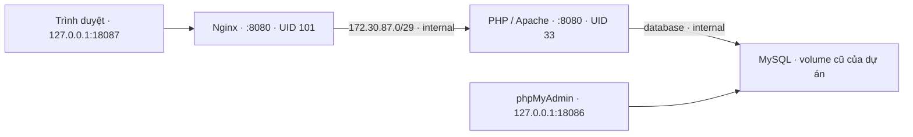

# Nghiệm thu Giai đoạn 2 — Nginx reverse proxy

**Ngày: 16/10/2026 (UTC+7). Commit nền: `fcc371b`.** Chỉ triển khai reverse proxy, giữ ứng dụng và MySQL. Chưa commit/push thay đổi này. Không triển khai Prometheus, Grafana, Loki hoặc Promtail.

## Kết luận

**Đạt yêu cầu Giai đoạn 2 trong môi trường localhost; đủ điều kiện chuẩn bị Commit 2 sau khi người dùng yêu cầu.** Website: **http://127.0.0.1:18087**. PHP backend không publish cổng host; 18085 đã bỏ khỏi Compose. phpMyAdmin vẫn ở **http://127.0.0.1:18086**, đăng nhập/truy cập MySQL thành công.

## Kiến trúc đã áp dụng



Giữ nguyên Compose project `attendance-phase1-fresh` và volume `attendance-phase1-fresh_phase1_data`. Nginx nối frontend + proxy, không nối database. Web nối proxy + database, không nối frontend. Nginx IP `172.30.87.2`, web `172.30.87.3`; subnet được kiểm tra không trùng các network Docker đang có. phpMyAdmin giữ nguyên mạng/cổng.

Trước khi sửa đã đọc Dockerfile, Compose, README, PHP ini, bootstrap, cấu trúc mạng và scripts. Kiến trúc mới đã được giải thích trước khi áp dụng. Lệnh triển khai chỉ cập nhật web/nginx bằng `up -d --build --no-deps web nginx`. **Docker Compose recreate web để bỏ port và thay network**; không chạy rm/down/prune, không tác động container của stack cũ/nhà hàng, không recreate hoặc restart MySQL/phpMyAdmin của dự án.

## Kết quả kiểm thử thực tế

| Bộ kiểm thử — lượt cuối từng bộ | Pass | Fail |
|---|---:|---:|
| Toàn bộ nghiệp vụ qua Nginx, `scripts/test.ps1` | 72 | 0 |
| Regression Giai đoạn 1 qua loopback trong web, `-BaseUrl http://127.0.0.1:8080` | 72 | 0 |
| Headers, giới hạn body, forwarding, fault upstream, `proxy-tests.php` | 51 | 0 |
| Peer không tin cậy từ mạng database, `untrusted-proxy.php` | 1 | 0 |
| Hạ tầng, secrets/Git, đăng nhập phpMyAdmin | 17 | 0 |
| Chrome qua Nginx 18087, responsive và submit form | 29 | 0 |
| **Tổng assertions** | **242** | **0** |

Ngoài tổng assertions: **9/9 file PHP ứng dụng qua `php -l`**, `nginx -t` và Compose config hợp lệ; đối chiếu dữ liệu, hash `.env` và ID container MySQL. Không cộng dồn các lần chạy lại trong quá trình sửa công cụ.

Các dòng tổng kết đã quan sát từ output:

```text
RESULT: 72 assertions passed
Test fixtures cleaned.
RESULT: 72 assertions passed
Test fixtures cleaned.
RESULT: 51 proxy assertions passed
PASS: untrusted database-network peer cannot bypass proxy using forged headers
RESULT: 17 infrastructure/security assertions passed
RESULT: 29 browser assertions passed
Browser fixtures cleaned.
```

Các chức năng thêm/sửa lớp, thêm/sửa/ngừng/khôi phục sinh viên, tạo buổi, lưu có mặt/vắng/muộn, lọc/phân trang lịch sử, tỷ lệ từng sinh viên, FK, chống trùng, chống điểm danh chéo lớp, validation, CSRF, SQL injection và escape XSS đều chạy qua Nginx bằng HTTP thật, không chỉ GET 200. Chrome submit form thật qua cổng host và xác nhận trạng thái lưu lại; 6 trang × 3 kích thước không tràn ngang toàn trang, bảng cuộn tới ô trạng thái.

## Headers và ranh giới tin cậy

Request thật từ Windows bằng `Invoke-WebRequest http://127.0.0.1:18087/` trả HTTP 200 và:

```text
X-Content-Type-Options: nosniff
X-Frame-Options: DENY
Referrer-Policy: same-origin
Content-Security-Policy: default-src 'self'; style-src 'self'; form-action 'self'; frame-ancestors 'none'; base-uri 'none'
```

Đã kiểm tra mỗi header xuất hiện **đúng một lần** trên document, CSS, 404, 403 (dotfile/CSRF), 413 và các phản hồi upstream giả lập 502/503/504. Nginx dùng `add_header ... always` và `proxy_hide_header` để không trùng với PHP. CSP không phụ thuộc CDN hoặc inline style/script, tương thích browser test.

Nginx chuyển `Host $http_host` để giữ host và cổng, thay X-Forwarded-For bằng `$remote_addr`, X-Forwarded-Proto bằng `$scheme`, xóa Forwarded do client gửi. Không nối chuỗi XFF không tin cậy. Apache chỉ chấp nhận peer Nginx `.2` hoặc loopback bên trong container, `RemoteIPInternalProxy` chỉ tin `.2`; HTTPS env chỉ được bật nếu peer `.2` và proto là https. Ở giai đoạn này Nginx chỉ phục vụ HTTP, nên client không thể gửi header để tự nâng thành HTTPS.

Test forwarding dùng listener nội bộ tạo từ cấu hình production, chuyển tới server echo tạm ngoài document root: Host `localhost:18087` được giữ, XFF giả `203.0.113.66` bị thay bằng peer thật `.3`, proto giả https trở thành http và Forwarded bị xóa. Test riêng từ phpMyAdmin đi thẳng tới Apache trên mạng database nhận 403 dù giả XFF là IP Nginx. Không có endpoint debug được thêm vào website.

## Timeout, kích thước và healthcheck

- Body tối đa **1 MiB**; gửi 1,048,577 byte nhận 413 và trang lỗi tiếng Việt.
- Connect timeout **3s**, proxy send/read **30s**, header timeout **10s**, body timeout **15s**, send timeout **30s**. Không retry upstream, tránh lặp POST. Các timeout đọc/ghi là thời gian chờ I/O, không phải deadline toàn giao dịch.
- `proxy_intercept_errors` chỉ thay trang cho 502/503/504; giữ status. Không lộ chi tiết upstream. Các lỗi nghiệp vụ 403/409/422 vẫn đi từ ứng dụng.
- Kiểm thử 502 connection refused, 503 do server giả trả và 504 do server giả chậm; sử dụng listener 18088/18089 **chỉ trong container**, không publish host. Timeout test rút xuống 1s để kiểm chứng cơ chế; chưa cố tình làm backend thật ngừng 30s hoặc tắt database đang chạy.
- Nginx UID 101, read-only rootfs, tmpfs `/tmp`, cap_drop ALL, no-new-privileges. Web UID 33. DB giữ tài khoản ứng dụng chỉ có DML.
- Health `/healthz` đi qua Nginx → PHP → SELECT 1 ở MySQL; `{"status":"ok"}`. Nginx/web/DB healthy ở kiểm tra cuối. PHP trả 503 chung nếu DB không sẵn sàng; chưa tắt DB thật để thử nhánh này.

## Bảo toàn dữ liệu và tài nguyên

Ban đầu bốn bảng đều **0 bản ghi**, checksum mỗi bảng là SHA-256 của `[]`: `4f53cda18c2baa0c0354bb5f9a3ecbe5ed12ab4d8e11ba873c2f11161202b945`.

Đã tạo riêng fixture có nhãn kiểm thử **trước khi recreate web**: lớp ID 25, sinh viên 45/46/47, buổi 57, mã lớp `B00112233445566778899aabb`. Sau recreate và các bộ test, vẫn thấy đủ 1 lớp, 3 sinh viên, 1 buổi và 3 lượt chưa ghi của bộ này. Hai file [before](phase2-data-before.json) / [after](phase2-data-after.json) là checksum hợp lệ **trước/sau lượt regression Nginx cuối**, không phải snapshot trước/sau lần deploy đầu; mọi hash đều trùng nhau.

Sau kiểm chứng chỉ dọn đúng fixture do nhiệm vụ tạo. [Snapshot cuối](phase2-data-final.json) xác nhận cả bốn bảng quay về baseline rỗng ban đầu với cùng checksum. Test không truncate hay xóa dữ liệu có sẵn. Auto-increment tăng do tạo/dọn fixture là hành vi bình thường, không được reset.

Container MySQL giữ nguyên ID `d43c618c0cf91a903a7e48131efc08ea274901abe4aa6e0fc93f189a21eb9e3a` và StartedAt `2026-10-16T09:58:09.431499116Z`. Hash SHA-256 của `.env` trước/sau đều `2187C7A718C47EF7312CE3C5EF685EB9F4BFC4A9A5D244621433072FD5BD4BCD`; không ghi đè `.env`. Các số này là metadata kiểm chứng, không phải mật khẩu.

Các container cũ `attendance-*`, `attendance-system-*`, `restaurant-*` và cổng cũ giữ nguyên. Nginx cũ đã exited và mailpit nhà hàng đã restart từ trước; không sửa chúng. Chỉ kiểm tra trạng thái quan sát được, không đọc nội dung dữ liệu dự án khác.

## Vấn đề đã gặp và sửa

1. Nginx không khởi chạy lần đầu vì `.2` được cấp động cho web. Đã cố định web `.3`, Nginx `.2`; khởi chạy và healthcheck đạt.
2. Công cụ fault ban đầu dùng Docker cp vào container read-only và thiếu đường tmpfs cho module phụ. Đổi sang stdin ghi vào `/tmp`, sinh cấu hình test từ cả `nginx.conf` và `default.conf` thật; giữ nguyên hardening production.
3. Server giả lập PHP một luồng còn sleep khi case 503 chạy, khiến test 503 nhận timeout. Đổi thứ tự chạy timeout cuối; không phải lỗi Nginx production.
4. phpMyAdmin tắt HTTP stream wrapper theo cấu hình mặc định. Chỉ bật cho tiến trình CLI của bài test peer không tin cậy, không sửa cấu hình phpMyAdmin.
5. Git khác owner giữa sandbox/Admin gây lỗi công cụ hạ tầng. Thêm `-c safe.directory=<workspace>` cho từng lệnh đọc, không sửa global hoặc repository cha.
6. **Kiểm tra checksum ban đầu có thể báo pass sai**: file PHP tạm mất sau recreate web và shell không kiểm tra exit code. Không dùng output lỗi đó làm bằng chứng. Bổ sung `scripts/data-fingerprint.ps1` kiểm tra copy, exit code và cấu trúc JSON; thay các snapshot bằng dữ liệu hợp lệ rồi chạy lại regression để đối chiếu. Kết quả cuối ở trên dựa trên công cụ đã sửa.
7. Lượt tạo fixture đầu bị từ chối vì tiền tố không đúng độ dài; đã dừng trước khi tạo dữ liệu, dùng lại định dạng hợp lệ cho bộ kiểm chứng.

## File tạo/sửa

- Sửa `Dockerfile`, `docker-compose.yml`; thêm `docker/proxy.conf`.
- Điền `nginx/default.conf`; thêm `nginx/nginx.conf`, `nginx/errors/upstream.html`, `nginx/errors/too-large.html`.
- Thêm `app/health.php`; không thay đổi logic điểm danh/schema/dữ liệu nghiệp vụ.
- Sửa `tests/integration.php` cho phép chọn TEST_BASE_URL; thêm `tests/proxy-tests.php`, `proxy-upstream.php`, `untrusted-proxy.php`, `data-fingerprint.php`.
- Sửa `scripts/test.ps1`, `browser-test.ps1`, `acceptance-check.ps1`, `setup-env.ps1`; thêm `proxy-test.ps1`, `proxy-fault-start.sh`, `proxy-fault-stop.sh`, `data-fingerprint.ps1`.
- Sửa `.env.example` (bỏ WEB_PORT cũ), README; `.env` không đổi.
- Thêm biên bản này, `phase2-screenshots.md`, ba JSON checksum, chín [ảnh Chrome thật](evidence/phase2/README.md).

Các file tạm `.tmp`, profile Chrome và logs được ignore. HEAD vẫn `fcc371b`; không stage, commit hoặc push trong giai đoạn này. Không có secrets được tìm thấy trong kiểm tra hạ tầng; `.env` không tracked.

## Giới hạn và rủi ro còn lại

- HTTP localhost, chưa HTTPS/HSTS, đăng nhập/phân quyền, rate limit hoặc audit ai sửa điểm danh; chưa kết luận sẵn sàng công khai Internet.
- Subnet/IP proxy cố định cần đồng bộ giữa Compose và Apache; nếu môi trường khác trùng subnet, phải chọn subnet mới và sửa cả hai, không tin toàn bộ mạng private.
- Người quản trị Docker/root vẫn có thể thay cấu hình và vượt ranh giới mạng; không coi cơ chế này chống được admin máy host.
- Chưa load test, kiểm thử deadline tổng, người dùng ghi đồng thời, backup/restore hoặc lỗi DB thật. DNS cập nhật có cửa sổ cache 10s sau thay đổi địa chỉ.
- Cookie Secure/HSTS cần cấu hình đồng bộ khi thêm HTTPS ở giai đoạn được cho phép sau này. IP client trên Docker Desktop có thể là địa chỉ NAT.
- Image tag chưa khóa digest; chưa scan CVE toàn stack. Healthcheck phản ánh readiness, Docker không tự restart chỉ vì unhealthy.
- Bộ test cần quyền Docker, Chrome và không nên chạy đồng thời. Ảnh tự động là dữ liệu kiểm thử, không phải ảnh dữ liệu thực; xem [hướng dẫn tự chụp](phase2-screenshots.md).

Không còn lỗi chức năng tái hiện được trong các kiểm thử cuối. **Đủ điều kiện tạo Commit 2 theo phạm vi cục bộ, nhưng chưa thực hiện commit/push.**
