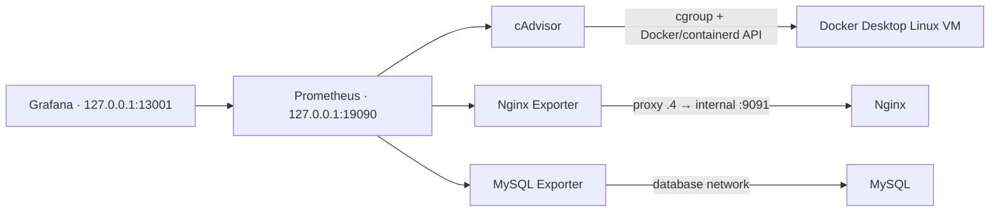

# Nghiệm thu Giai đoạn 3 — Prometheus và Grafana

Ngày **16/10/2026 (UTC+7)**. Commit nền `70bdee6`. **Đã triển khai và kiểm thử cục bộ, đủ điều kiện chuẩn bị Commit 3; chưa stage/commit/push.**

## Khôi phục điều kiện lưu trữ

Lần triển khai trước bị chặn vì ổ C còn khoảng 26 MiB, containerd gặp I/O rồi read-only filesystem. Người dùng đã chuyển disk image Docker sang D và giữ backup tại `E:\DockerBackup`; agent không chuyển/xóa disk hoặc truy cập/sửa bản sao lưu.

Đầu lượt tiếp tục: C trống **17,497,473,024 byte (~16.3 GiB)**, D trống **109,681,577,984 byte (~102.2 GiB)**. Đã đọc `settings-store.json`: `CustomWslDistroDir = D:\DockerDesktopData\DockerDesktopWSL`. File VHDX thật ở `D:\DockerDesktopData\DockerDesktopWSL\disk\docker_data.vhdx` tiếp tục cập nhật sau pull/chạy container. Cuối lượt C còn **17,359,589,376 byte**, D còn **108,238,737,408 byte**. Không còn quan sát lỗi I/O/read-only ở các thao tác triển khai này.

Ban đầu đủ 13 container và 5 named volumes. Giữ toàn bộ tài nguyên cũ, thêm 5 container monitoring và 2 volume Prometheus/Grafana. Chỉ recreate Nginx của project để thêm mount status và cAdvisor khi sửa cấu hình; không recreate/restart MySQL, web, phpMyAdmin hoặc container dự án khác trong lượt này.

## Kiến trúc và URL thực tế



- Website: http://127.0.0.1:18087 ; phpMyAdmin: http://127.0.0.1:18086 .
- Prometheus: http://127.0.0.1:19090 ; targets: http://127.0.0.1:19090/targets .
- Grafana: http://127.0.0.1:13001 ; dashboard: http://127.0.0.1:13001/d/attendance-system .
- Grafana user/mật khẩu lấy từ `.env.grafana`, không ghi trong tài liệu/Git.

Project vẫn `attendance-phase1-fresh`, 9 service: nginx, web, db, phpmyadmin, prometheus, grafana, cadvisor, nginx-exporter, mysql-exporter. Không có Loki/Promtail. Prometheus/Grafana bind loopback, exporter không publish host. Monitoring network internal; UI có mạng riêng. Nginx exporter nối proxy với IP `.4`, MySQL exporter nối database; Prometheus/Grafana không nối database. PHP backend tiếp tục không publish cổng.

Prometheus v3.15.0, Grafana 13.2.4, cAdvisor 0.55.1, Nginx Exporter 1.5.1, MySQL Exporter v0.20.0. Scrape 15s, timeout 5s; Prometheus giữ TSDB 7 ngày/1GB trên volume riêng. Grafana có volume riêng và datasource provisioned `attendance-prometheus` → `http://prometheus:9090`.

## Targets và metrics

**4 UP / 0 DOWN**, đã đọc từ API Prometheus sau khi readiness ổn định:

| Job | Target | Health |
|---|---|---|
| prometheus | prometheus:9090 | UP |
| cadvisor | cadvisor:8080 | UP |
| nginx | nginx-exporter:9113 | UP |
| mysql | mysql-exporter:9104 | UP |

Ngoài scrape UP, `nginx_up=1` và `mysql_up=1` chứng minh exporter truy cập được dịch vụ. cAdvisor có label project/service và số liệu từng container; không dùng host metrics thay cho container. Prometheus lọc cAdvisor chỉ lưu project attendance-phase1-fresh; đã kiểm tra không có memory series project khác.

Dashboard **Attendance System Monitoring** provisioned 9 panel, tất cả có series hữu hạn qua Prometheus **và** trả giá trị qua Grafana datasource query API:

| Panel | Series tại lượt kiểm tra |
|---|---:|
| Container CPU | 9 |
| Container RAM (working set) | 9 |
| Container network receive | 9 |
| Container network transmit | 9 |
| Nginx requests per second | 1 |
| MySQL connections (current) | 1 |
| Nginx active connections | 1 |
| MySQL total connections | 1 |
| Prometheus scrape target health | 4 |

Không dùng dữ liệu giả hoặc fallback `vector(0)`. `up` là tình trạng scrape target, không chứng minh nghiệp vụ end-to-end. CPU dùng phần trăm một CPU, có thể vượt 100% với nhiều core.

## Kết quả kiểm thử thực tế cuối

| Bộ kiểm thử | Pass | Fail |
|---|---:|---:|
| Monitoring API, metrics từng container, traffic và Grafana queries | 54 | 0 |
| Truy cập Grafana và ACL Nginx status | 4 | 0 |
| Nghiệp vụ PHP/MySQL qua Nginx | 72 | 0 |
| Hạ tầng, secrets/Git, phpMyAdmin login | 17 | 0 |
| **Tổng assertions của lượt cuối từng bộ** | **147** | **0** |

Thêm: **9/9 file PHP ứng dụng qua php -l**, `docker compose config --quiet`, `nginx -t`, `promtool check config` đều đạt. Đây là kết quả mới, không cộng lại 242 assertions Giai đoạn 2 hoặc các lần retry.

Kết quả monitoring có thể kiểm tra tại [phase3-test-results.json](phase3-test-results.json), thời điểm `2026-10-16T20:07:02.5271526+07:00`. Các dòng tổng kết thực tế:

```text
RESULT: 54 monitoring assertions passed; 0 failed
RESULT: 4 monitoring access assertions passed
RESULT: 72 assertions passed
Test fixtures cleaned.
RESULT: 17 infrastructure/security assertions passed
```

Sau **40 request website thật** và chờ ít nhất hai scrape:

| Counter | Trước | Sau |
|---|---:|---:|
| Nginx HTTP requests | 173 | 220 |
| MySQL total connections | 442 | 498 |
| Web CPU usage seconds | 3.571085 | 3.763784 |
| Web network receive bytes | 774321 | 893132 |

Mức tăng có cả healthcheck/scrape và truy cập kiểm tra khác, không quy toàn bộ mức tăng cho 40 request. Đã kiểm tra riêng CPU/RAM/network cho web, nginx, db và phpmyadmin; các panel tổng hợp có đủ 9 service.

Regression nghiệp vụ gồm quản lý lớp/sinh viên, ngừng/khôi phục, tạo buổi, ba trạng thái, lưu lại không trùng, lịch sử/phân trang, thống kê, validation, CSRF, SQL injection, escape XSS, FK và nhất quán lớp. Test chỉ tạo/dọn fixture riêng, không truncate hoặc sửa dữ liệu có sẵn.

Kiểm soát truy cập: Grafana dashboard API không auth trả 401; `/stub_status` trên website công khai trả 404; web peer `.3` gọi listener status nội bộ bị 403; exporter `.4` vẫn scrape được. Headers website được giữ nguyên. Chưa chạy lại Chrome responsive hoặc kiểm tra đồ họa dashboard bằng trình duyệt trong lượt này; xác minh panel dựa trên API Grafana/Prometheus.

## MySQL, secrets và bảo toàn dữ liệu

Monitoring account `attendance_monitor`@`%` giữ **USAGE** và `MAX_USER_CONNECTIONS=3`. Exporter chỉ bật global_status/global_variables; collector cần replication/đọc bảng đã tắt. Kiểm chứng SQL thật: SELECT 1 và SHOW GLOBAL STATUS thành công; SELECT bảng students bị ERROR 1142; giới hạn kết nối bằng 3. Không cấp SELECT, PROCESS, REPLICATION CLIENT và không dùng root/app account trong exporter.

Credentials monitoring được giữ từ lần chuẩn bị trước, không sinh lại. `.env` ứng dụng không đổi; `.env.grafana` và `secrets/` bị ignore cả Git và build context. Không in mật khẩu/token vào output, không stage chúng. MySQL root chỉ được dùng bên trong container khi áp dụng CREATE USER IF NOT EXISTS; không đổi mật khẩu user đã tồn tại.

[Checksum trước](phase3-resume-data-before.json) và [sau](phase3-resume-data-after.json) trùng hoàn toàn cho cả bốn bảng: 0 bản ghi/bảng, SHA-256 của `[]` là `4f53cda18c2baa0c0354bb5f9a3ecbe5ed12ab4d8e11ba873c2f11161202b945`. Auto-increment tăng theo fixture là bình thường, không reset.

MySQL container ID vẫn `d43c618c0cf91a903a7e48131efc08ea274901abe4aa6e0fc93f189a21eb9e3a`. StartedAt sau đợt chuyển ổ do người dùng thực hiện là `2026-10-16T12:55:32.406097037Z`, không thay đổi trong lượt triển khai tiếp tục này. Volume vẫn `attendance-phase1-fresh_phase1_data`; MySQL healthy, phpMyAdmin đăng nhập/truy cập database đạt. Backup `E:\DockerBackup` không bị thao tác.

## Lỗi đã xử lý

1. **Lỗi lưu trữ trước đó:** người dùng chuyển Docker sang D, đã đối chiếu setting CustomWslDistroDir và file VHDX. Pull Grafana hoàn tất, không lặp lỗi metadata read-only.
2. **cAdvisor UP nhưng không có Docker metrics:** Docker factory không đăng ký vì mặc định tìm `/run/containerd/containerd.sock` bên trong container. Socket thật đã có trong mount `/rootfs`; thêm `--containerd=/rootfs/run/containerd/containerd.sock`. Docker/containerd factories đăng ký thành công và metrics từng container xuất hiện. Không thêm mount/quyền mới.
3. **Collector disk quét thư mục riêng bị từ chối:** tắt collector disk ngoài phạm vi yêu cầu. Không bật privileged hoặc cấp capability để đọc thư mục database/apt cache. CPU/RAM/network vẫn đạt. OOM events không bật vì không cấp `/dev/kmsg`.
4. **Race khi test vừa recreate cAdvisor:** một lượt báo 38 pass/1 fail vì đọc trạng thái scrape cũ ngay lúc startup, trong khi các query sau đã có dữ liệu. Thêm chờ readiness và initial scrape; lượt cuối mở rộng đạt 54/54. Không ghi lượt lỗi đó thành pass.
5. Đổi tên panel health thành **Prometheus scrape target health** để không mô tả `up` như kiểm tra nghiệp vụ ứng dụng.

Lỗi preflight 8 pass/2 fail và storage read-only của lần trước được giữ tại `phase3-preflight-results.json` như lịch sử, không phải kết quả hiện tại.

## File tạo/sửa Giai đoạn 3

- `docker-compose.yml`, `.gitignore`, `.dockerignore`, `README.md`.
- `prometheus/prometheus.yml`, `nginx/monitoring.conf`.
- `grafana/provisioning/datasources/prometheus.yml`, `grafana/provisioning/dashboards/attendance.yml`, `grafana/dashboards/attendance-system.json`.
- `scripts/setup-monitoring.ps1`, `start-monitoring.ps1`, `apply-monitoring-user.sh`, `test-monitoring-user.sh`, `build-monitoring-dashboard.ps1`, `monitoring-test.ps1`, `monitoring-access-test.ps1`; sửa số service trong `acceptance-check.ps1`.
- `tests/monitoring-access.php`; các JSON kết quả/checksum, biên bản và hướng dẫn ảnh Giai đoạn 3.
- Cục bộ được ignore: `.env.grafana`, `secrets/mysql-exporter.cnf`, `secrets/monitoring-user.sql`.

Không sửa Dockerfile/PHP nghiệp vụ/schema; không sửa Loki/Promtail hoặc dự án nhà hàng. Không xóa container/volume/database, không prune/down -v; Compose chỉ thay các instance Nginx/cAdvisor cần cập nhật như nêu trên. HEAD vẫn 70bdee6, chưa stage/commit/push.

## Rủi ro và phần chưa kiểm thử

- cAdvisor chạy root, cgroup host, đọc host rootfs/sys/DockerRootDir và Docker/containerd sockets. Không privileged, cap_drop ALL; nhưng socket `:ro` không ngăn API mutation nếu bị chiếm quyền. cAdvisor có thể quan sát metadata container khác trên daemon; chỉ dữ liệu lưu Prometheus được lọc project. Chưa có socket proxy/API allowlist.
- Không cấp `/dev/kmsg`, nên không thu OOM events; disk collector bị tắt. Cảnh báo thiếu machine-id/DMI hoặc Podman/CRI-O không có trên Docker Desktop không cản CPU/RAM/network.
- Prometheus UI không auth, cả hai UI dùng HTTP loopback. Không public Internet; Docker admin có thể đọc env credentials. Chưa CVE scan, khóa digest hoặc backup/restore TSDB/Grafana.
- Chưa alert rules/Alertmanager, blackbox website probing, Loki/Promtail, load test, lỗi DB thật hoặc kiểm thử outage exporter. Target UP không thay thế giám sát nghiệp vụ.
- Dashboard được xác minh bằng API, chưa kiểm tra trực quan trên mọi trình duyệt. Người dùng chụp ảnh thật theo [phase3-screenshots.md](phase3-screenshots.md); không có ảnh minh chứng giả được tạo.
- Vị trí containerd hiện phù hợp Docker Desktop này, cần kiểm tra lại khi chạy trên Linux/phiên bản Docker khác. Sau restart/recreate cần ít nhất 2 scrape cho rate panels.

**Kết luận: đủ điều kiện tạo Commit 3 theo phạm vi giám sát cục bộ đã kiểm thử. Chưa commit hoặc push.**