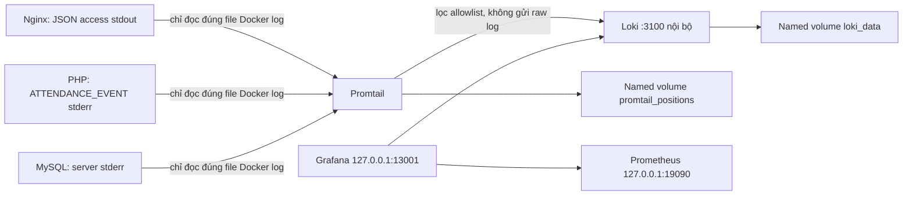

# Nghiệm thu Giai đoạn 4 — Loki + Promtail

Ngày 16/10/2026, UTC+7. Workspace `C:\Users\Admin\OneDrive\Desktop\attendance-system`, branch `main`, commit nền `344f50c`. **Đã triển khai và kiểm thử thực tế; chưa stage, commit hoặc push.** Không dùng ảnh minh chứng giả.

## Quyết định phiên bản và phạm vi

[Grafana xác nhận Promtail EOL từ 02/03/2026](https://grafana.com/docs/alloy/latest/set-up/migrate/from-promtail/), không còn bảo trì. Đã đề xuất Alloy trước triển khai; người dùng chọn **bắt buộc Promtail cho bài thi cục bộ, ghi rõ rủi ro EOL**. Sử dụng `grafana/promtail:3.5.12`, `grafana/loki:3.7.8`; đã kiểm tra manifest, pull image và chạy thật. Không triển khai Alloy thay thế trong lượt này.

Đã đọc Compose/Dockerfile, Nginx, PHP/bootstrap/PDO, schema/quyền/trigger MySQL, Prometheus, Grafana provisioning/dashboard, README và scripts hiện có. `loki/config.yml`, `promtail/config.yml` ban đầu rỗng. Giữ project name `attendance-phase1-fresh` và volume database hiện có.

## Kiến trúc thực tế



Website vẫn http://127.0.0.1:18087, phpMyAdmin http://127.0.0.1:18086. Loki/Promtail không publish host port, chỉ nối mạng `monitoring` internal. Grafana dùng `http://loki:3100` qua datasource proxy đã xác thực. Dashboard metrics `attendance-system` giữ 9 panel; thêm `attendance-logs` gồm 4 panel: Service logs, Nginx HTTP 404, PHP application logs, rolling count 5 phút theo service, kèm service/level/time filters.

Loki UID 10001, root filesystem read-only, RAM tối đa 512 MiB, CPU 0.5. TSDB schema v13, filesystem trên volume riêng, index 24 giờ, compactor retention 168 giờ, delete delay 2 giờ, worker 2. Thiết lập theo [retention](https://grafana.com/docs/loki/latest/operations/storage/retention/) và [filesystem storage](https://grafana.com/docs/loki/latest/operations/storage/filesystem/). Promtail RAM 128 MiB, CPU 0.25, filesystem read-only, position volume riêng. Hai dịch vụ không privileged, không capabilities, no-new-privileges.

Promtail cần UID 0 để đọc Docker log thuộc root nhưng chỉ được mount **ba file** JSON log chính xác, read-only. Không mount Docker socket, `/var/lib/docker/containers` hoặc thư mục metadata có thể chứa passwords. `scripts/start-logging.ps1` xác minh container/project/driver, sinh override JSON hợp lệ với YAML tại `docker-compose.override.yml` (ignored), không ghi secrets. Không ghi đè override không phải do script tạo.

Nhãn: `job=attendance`, `service=nginx|php|mysql`, `container`, `log_type`, `level`, `status` khi có. Request ID không làm label. Nginx dùng map allowlist route/method, không ghi query/body/IP/cookie; ghi đè request ID đầu vào bằng ID do Nginx tạo. PHP chỉ ghi sự kiện/status/method/route/request ID, exception không ghi message hoặc trace. Promtail loại dòng không đúng mẫu; MySQL chỉ gửi severity và mã `MY-xxxxxx`, không gửi nội dung message hoặc SQL. Không bật general/slow query log, không đổi tài khoản/quyền MySQL.

## Lệnh và kết quả chạy thật

| Bộ kiểm tra, lệnh đã chạy | PASS | FAIL ở lượt cuối |
|---|---:|---:|
| `scripts/logging-test.ps1` | 48 | 0 |
| `scripts/test.ps1` — nghiệp vụ qua Nginx | 72 | 0 |
| `scripts/monitoring-test.ps1 -ResultPath docs/phase4-monitoring-results.json` | 54 | 0 |
| `scripts/monitoring-access-test.ps1` | 4 | 0 |
| `scripts/acceptance-check.ps1` | 17 | 0 |
| `scripts/logging-final-check.ps1` | 17 | 0 |
| **Tổng assertion của lượt cuối mỗi bộ** | **212** | **0** |

PHP lint riêng: **9/9 file ứng dụng hợp lệ**, không cộng lại vào 212 assertions. `docker compose config --quiet`, `nginx -t`, `promtool check config` thành công. Regression bao gồm CRUD lớp/sinh viên/buổi điểm danh, ba trạng thái điểm danh, lịch sử/thống kê, CSRF, XSS, SQL injection, FK/unique, consistency khác lớp, user DB hạn chế quyền và dọn riêng fixture sinh bởi test. Không xóa dữ liệu cũ.

Đã dùng `docker compose build web`, `docker compose up -d --no-deps web loki`, kiểm tra rồi reload Nginx, restart riêng Grafana để nhận datasource; `scripts/start-logging.ps1` khởi động Loki/Promtail. Khi đổi mount sang từng file chỉ recreate Promtail. Không chạy `down`, `down -v`, prune, reset, không sửa hoặc dừng container dự án khác.

Lượt logging cuối trước persistence kiểm tra 48/48, lấy request thật mới cho `/classes.php` và `/phase4-log-proof`, nhận HTTP 200/404 và `X-Request-ID` dạng 32 hex. Tìm thấy đúng ID trong Loki cho cả Nginx và PHP; request CSRF sai trả 403 và tìm được event PHP `level=warn,status=403`. Canary trong query/cookie/request ID giả không xuất hiện trong log Loki. Mọi dòng JSON lấy mẫu chỉ có các trường đã cho phép. Test exception chạy CLI ngoài document root xác minh không ghi message/stack trace; không tuyên bố đây là exception HTTP mới được ingest.

Cả 4 panel log được truy vấn qua **Grafana `/api/ds/query`** và trả frame có dữ liệu thật; datasource Loki health `OK`. Các panel không nhúng dữ liệu mẫu. 9 panel Prometheus cũng trả dữ liệu thật qua Grafana API. Sau 40 request website, CPU/network web, Nginx request counter và MySQL connection counter tăng. Prometheus **4 UP / 0 DOWN**: self, cAdvisor, Nginx exporter, MySQL exporter.

Kết quả máy đọc được: [logging](phase4-test-results.json), [monitoring regression](phase4-monitoring-results.json), [final checks/runtime](phase4-final-results.json). File logging có request ID thật cho lần chạy cuối, không có credentials.

### Ba truy vấn LogQL đã chạy thành công

```logql
{job="attendance",service="nginx"}
{job="attendance",service="nginx"} | json | status = 404
sum by (service) (count_over_time({job="attendance"}[5m]))
```

Hai truy vấn log được chạy dạng range, truy vấn count chạy instant; tất cả trả `status=success` và ít nhất một series thực. Query 404 còn được lọc theo request ID thực để tránh coi log cũ là minh chứng request mới. PHP xem bằng `{job="attendance",service="php"}`. MySQL xem bằng `{job="attendance",service="mysql"}` với cửa sổ 2 giờ ở lượt kiểm thử, vì log máy chủ chủ yếu từ lúc DB khởi động; không ép tạo lỗi hoặc restart DB. Count 5 phút chỉ trả những service có log trong khoảng đó, không giả series MySQL.

### Dữ liệu, container và dung lượng

Fingerprint trước/sau được lấy bằng `scripts/data-fingerprint.ps1`, lưu tại [before](phase4-data-before.json) và [after](phase4-data-after.json). Bốn bảng `classes`, `students`, `sessions`, `attendance` đều 0 dòng trước và sau, SHA256 từng bảng khớp. Đây là trạng thái dữ liệu thật được quan sát, không tuyên bố đã bảo toàn các bản ghi không tồn tại. MySQL vẫn cùng ID `d43c618c0cf91a903a7e48131efc08ea274901abe4aa6e0fc93f189a21eb9e3a`, StartedAt `2026-10-16T12:55:32.406097037Z`, volume `attendance-phase1-fresh_phase1_data`; không recreate/restart DB. phpMyAdmin kiểm tra cả HTTP và đăng nhập DB bằng app user thành công.

Cuối final check: **11/11 service running**, không OOM. Docker healthcheck `healthy`: Nginx, web, MySQL, cAdvisor, Promtail. Loki là image distroless không có shell/wget, **không gán Docker healthcheck giả**; kiểm tra `/ready` thật từ Grafana và query/datasource thành công. Grafana/Prometheus/exporter kiểm tra bằng API/targets thật, không tuyên bố tất cả container có Docker healthcheck.

Đã restart riêng Loki/Promtail để kiểm tra persistence: Loki ready trở lại, tìm được cùng request 404 trước restart, file positions vẫn có dữ liệu và Promtail ready. Các volume giữ nguyên. Ở lần ghi final result: C trống **9,316,823,040 byte (~8.68 GiB)**, D trống **107,768,975,360 byte (~100.37 GiB)**. Docker settings `CustomWslDistroDir` và VHDX thực xác nhận trên `D:\DockerDesktopData\DockerDesktopWSL`. Không truy cập/sửa/xóa backup E.

Secrets scan trên candidate tracked/untracked không bị ignore: không thấy giá trị mật khẩu thật từ `.env`, `.env.grafana`, exporter credentials hoặc mẫu private token/key. `.env`, `.env.grafana`, `secrets/`, override đều ignored. Không stage, HEAD vẫn `344f50c`.

## Lỗi phát hiện và xử lý

1. `tmpfs` dạng flow-list chứa dấu phẩy không đặt quote khiến Docker hiểu `noexec` là mount path; đã quote cả chuỗi. Compose config chỉ kiểm tra schema, không bắt được lỗi runtime này. Sau sửa Loki khởi động bình thường.
2. Lượt startup Compose lỗi giữa chừng để tên web có prefix ID. Đã hoàn tất recreate web và khôi phục tên service chuẩn; health/72 regression đạt sau đó. Không ảnh hưởng DB.
3. Regex cuối dòng chưa tính newline trong Docker log: lượt đầu **33 PASS/12 FAIL**, collector đọc file nhưng bỏ cả dòng hợp lệ. Thêm `\s*$`, sau đó request thật đã ingest.
4. Test readiness chạy ngay sau restart Promtail gặp startup delay: lượt tiếp **44 PASS/1 FAIL**. Bổ sung polling readiness có timeout; lượt cuối 48/48.
5. Mount thư mục log ban đầu rộng hơn cần thiết, có thể đọc metadata chứa biến môi trường. Đã thay bằng đúng từng file log; chạy lại đủ 48 checks sau thay đổi và final persistence pass.
6. Test Giai đoạn 3 từng yêu cầu không có logging và 9 services. Cập nhật expectation cho Giai đoạn 4 (11 services), giữ các assertion nghiệp vụ/metrics/security; thêm tham số output để không ghi đè biên bản Giai đoạn 3.

Các thất bại phát hiện lúc phát triển được ghi ở trên; **212/0 là tổng lượt cuối mỗi bộ**, không xóa lịch sử lỗi bằng cách cộng dồn các lượt chạy.

## Giới hạn và rủi ro còn lại

- Promtail EOL, chấp nhận chỉ cho bài thi cục bộ theo lựa chọn người dùng. Cần chuyển Alloy trước sử dụng lâu dài.
- Promtail chạy UID 0 để đọc file root-owned; mount file read-only/cap-drop giảm phạm vi nhưng không biến thành non-root. cAdvisor giữ quyền nhạy cảm của Giai đoạn 3, không được mở rộng trong lượt này.
- Bind mount theo ID/inode: sau recreate nguồn chạy lại start script; sau Docker log rotation cần restart Promtail và kiểm tra log mới. Chưa kiểm thử tình huống rotation thật, crash đột ngột hoặc di chuyển disk tiếp theo. Không cấu hình lại Docker log driver của DB để tránh recreate DB.
- Retention 7 ngày đã xác minh cấu hình và khởi động, **chưa chờ đủ 7 ngày để kiểm tra xóa theo thời gian**. Filesystem Loki không tự xóa theo mức đĩa trống; Docker raw logs không thuộc retention Loki, cần theo dõi dung lượng. Không thay log rotation toàn Docker hoặc ảnh hưởng dự án khác.
- Raw Docker Apache access/Nginx error có thể chứa IP/query; Promtail loại chúng và không gửi Loki. Root Docker host vẫn có thể đọc raw log, không cam kết raw Docker logging hoàn toàn không có dữ liệu nhạy cảm. Log MySQL đã bỏ nội dung nên giảm khả năng chẩn đoán chi tiết.
- Loki không auth/TLS nhưng chỉ trong mạng monitoring nội bộ, không publish host; các thành phần cùng mạng vẫn có thể truy cập. UI Grafana dùng HTTP loopback, không áp dụng cho public production.
- Dashboard/datasource/filter config và dữ liệu được kiểm bằng API; chưa tự động kiểm tra thao tác/render bộ lọc Grafana trên trình duyệt trong lượt này. Người dùng tự chụp ảnh thật theo [hướng dẫn](phase4-screenshots.md); chưa tạo ảnh mới trong lượt này.

## Danh sách file thay đổi

26 file dự kiến thuộc Giai đoạn 4 (9 file tracked sửa, 17 file mới/untracked; chưa stage):

- Cấu hình chung: `docker-compose.yml`, `.gitignore`, `.dockerignore`, `README.md`.
- Ứng dụng/proxy: `app/includes/bootstrap.php`, `nginx/nginx.conf`, `nginx/default.conf`.
- Logging: `loki/config.yml`, `promtail/config.yml`, `promtail/healthcheck.sh`.
- Grafana: `grafana/provisioning/datasources/loki.yml`, `grafana/dashboards/attendance-logs.json`.
- Script sửa: `scripts/acceptance-check.ps1`, `scripts/monitoring-test.ps1`.
- Script mới: `scripts/start-logging.ps1`, `scripts/build-logging-dashboard.ps1`, `scripts/logging-test.ps1`, `scripts/logging-final-check.ps1`.
- Test: `tests/logging-exception.php`.
- Tài liệu/kết quả: `docs/phase4-validation.md`, `docs/phase4-screenshots.md`, `docs/phase4-data-before.json`, `docs/phase4-data-after.json`, `docs/phase4-test-results.json`, `docs/phase4-monitoring-results.json`, `docs/phase4-final-results.json`.

File runtime sinh cục bộ `docker-compose.override.yml` ignored, không thuộc 26 file dự kiến commit. Không ghi đè `.env` hoặc `.env.grafana`. Không thêm ảnh trong lượt này. Inventory cuối: 20 container (11 attendance, 9 container khác vẫn tồn tại), 9 named volumes (thêm đúng Loki/positions so với 7 volume đầu kỳ).

## Kết luận

**Đủ điều kiện kỹ thuật chuẩn bị Commit 4 cho bài thi cục bộ**, với ngoại lệ Promtail EOL và các giới hạn trên đã công khai. Cần người dùng nghiệm thu/chụp ảnh thật nếu báo cáo yêu cầu ảnh trước khi yêu cầu commit. Chưa commit/push.
